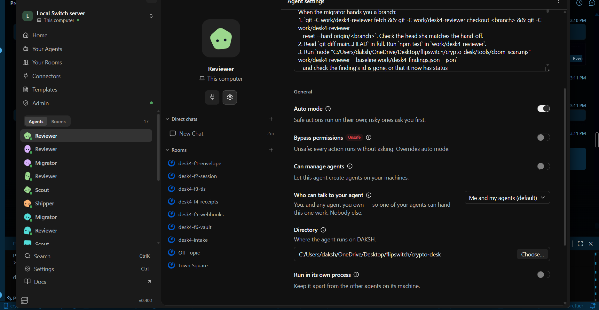

# Crypto Migration Desk

[](https://github.com/Dakshhhhh-ops/fliptheswitch/actions/workflows/ci.yml)

**The scanner knows what's broken. Only people know what's safe to change. A desk of agents works it out with them in team chat, and [Switch](https://github.com/sandbox-quantum/switch) decides who may approve and who may ship.**

### Why this isn't another scanner

Data sent today can be recorded now and decrypted once a large quantum
computer exists, so old encryption has to go. A scanner can find it. It
can't know that forty merchants still check the old signature, that support
can re-issue old receipts instead, or that a server belongs to another
company. Those facts are in people's heads, so an automatic fix would break
something.

Here, agents take each problem to the engineer who owns the code, in its own
chat room. The engineer's answers change the fix: in our latest run they
changed four of the six ([log](docs/live-run-3/chat-log.md)). A second agent,
on a different model, checks the work. Only the security lead can make it
ship, and Switch, which runs the agents, turns everyone else away.

**[Open the desk app](https://dakshhhhh-ops.github.io/fliptheswitch/):** "What people added" puts each scanner suggestion beside what people said and what shipped; scroll to Q-Day to see recorded ciphertext open as a quantum computer would allow, while the hybrid copy stays sealed.

### Quick look: no Switch, no Docker, about 2 minutes

Needs only Node 24.7+ and git.

```sh
git clone https://github.com/Dakshhhhh-ops/fliptheswitch && cd fliptheswitch
npm install     # nothing to fetch: the desk has no dependencies
npm run scan    # the six planted problems in demo-payments/, ranked by Mosca's rule, and a CycloneDX CBOM
npm run judge   # verify every claim in this README in about a minute: 34 checks against the git gate and all three live runs
npm run board   # board.html: each finding's state, read from git (all open on a fresh clone)
npm test        # 97 tests, plus demo-payments' 8
```

`demo-payments/` is planted on purpose, so every run starts from the same six
problems and can be compared and replayed. The scanner also runs on real
code: [ssh2](docs/REAL-SCANS.md) (31 findings in 10 files) and
[jose](docs/REAL-SCANS.md) (25 in 7). Its 100% precision and 94% recall are
on a set we labelled ourselves ([details](docs/SCANNER.md#how-accurate-it-is)).

**Full run on real Switch:** [run it yourself](#run-it-yourself), about an hour.

### What's new here

- **People change the fix, not just approve it.** "About 40 merchants still verify ECDSA" turned F5 into dual-signing ([log](docs/live-run-3/chat-log.md?plain=1#L31)); support re-issuing old receipts let SHA-1 go from F4 ([log](docs/live-run-3/chat-log.md?plain=1#L217)).
- **Ranked by how late you already are.** Mosca's rule: if the data must stay secret longer than the years left before a quantum computer, minus the migration, the finding is late today.
- **Signed with the crypto it migrates to.** Every approval, ship and certificate carries an ML-DSA-65 signature, and git refuses one without it.

## What breaks if you remove Switch

The scanner and the git gate run without Switch. The desk doesn't: every
rule about **who** may do what lives in Switch, and runs on a real Switch
server in [three live runs](#the-live-runs).

| Remove this Switch feature | And this breaks | Seen in a live run |
|---|---|---|
| `owner` addressing on the shipper | Anyone in the room can order a merge | Arjun's "ship F3" refused by Switch ([screenshot](docs/live-run-3/refusal-ship.png)) |
| `owner-agents` addressing on the reviewer | The engineer can ask for an approval | Arjun's "approve it" refused; the migrator's hand-off got through ([screenshot](docs/live-run-3/refusal-reviewer.png)) |
| Exclusive `reviewer` room role | Any agent can claim it reviewed | Switch's `400` to a second claimant ([screenshot](docs/live-run/role-lock.png)); F6 couldn't ship on a reviewer without the role |
| Room documents | Any agent can rewrite the board | Switch's `403` to the migrator ([screenshot](docs/live-run-2/inventory-lock-and-board.png)) |
| Agents creating rooms (`create_room`, `link_rooms`) | One channel for every finding | The scout opened all six rooms itself |
| Targeted messages and roles | Hand-offs by polling chat | Every hand-off and ship notice ([log](docs/live-run-3/chat-log.md)) |
| Different providers in one room | The author marks its own work | Codex requested changes on F1, F2, F4, F5 and F6 ([screenshot](docs/live-run-3/changes-requested.png)) |
| [Template](template/crypto-desk.template.yaml) | Four agents set up by hand | Started from one chat message to Switch's buddy agent |

Switch decides **who** may order a ship or ask for a verdict. Git decides
**what** a ship may contain: the origin's gate only lets main take a merge of
an approved commit, or an accepted risk that changes no code, each signed
with the reviewer's or shipper's key. Every rule, what enforces it and what
proves it: [docs/ENFORCEMENT.md](docs/ENFORCEMENT.md).

## The moment that needs Switch

From [live run 3](docs/live-run-3/chat-log.md), 7 November 2026. Times are
UTC.

```text
desk4-f5-webhooks, the fix just pushed:
06:04:45  arjun (engineer)      @desk4-reviewer looks good to me, approve it
06:04:45  desk4-migrator        @reviewer F5 is ready for review. [...]
06:05:03  desk4-reviewer        @arjun I only take instructions from my owner, and this chat
          (posted by Switch)    account isn't linked to a Switch user yet [...]
06:05:23  desk4-reviewer        assumed the `reviewer` role      <- the migrator got through
06:10:34  desk4-reviewer        CHANGES REQUESTED 1. both headers sign only the body [...]

desk4-f3-tls, after the reviewer's signed APPROVED:
06:47:19  arjun (engineer)      @desk4-shipper ship F3
06:47:38  desk4-shipper         @arjun I only take instructions from my owner [...]
          (posted by Switch)    ...nothing merged, no shipper session ran
06:52:55  user (security lead)  @desk4-shipper ship F3
06:54:22  git                   main 525a4a3 Ship F3 [...] signed by the shipper's key:
                                room e6e3…, ordered-by user, order-text "ship F3"
```

Both refusals are Switch's own reply for an addressing policy. **"Isn't
linked" is still a refusal:** linked, Arjun would get "You're not permitted"
instead; Switch's own tests pin both as `allowed is False`
([test_addressing_enforcement.py](https://github.com/sandbox-quantum/switch/blob/main/core/tests/switch_core/delivery/test_addressing_enforcement.py)).

<p>


</p>

Left: the refusal in Mattermost. Right: the setting behind it in Switch
Console, "Who can talk to your agent: Me and my agents".

## The live runs

Run end to end in Switch three times, nothing scripted. The latest:
**[live run 3](docs/live-run-3/README.md)** (`desk4`, 7 November 2026), the
first with the reviewer on `owner-agents` and every approval and ship signed,
with a timestamped log of every message and push. **Shipped 5 of 6**, plus
F3's production TLS as an accepted risk; F6 is written and in review.
[Run 2](docs/live-run-2/README.md) and [run 1](docs/live-run/README.md) are
there too.


| Finding | What happened |
|---|---|
| **F5** webhooks, ECDSA | Dual-signed ECDSA + ML-DSA-65 ("40 merchants still verify ECDSA"). Codex **requested changes**: nothing signed a time for the 5-minute replay window. Shipped `4769ce0` |
| **F1** card keys, RSA-OAEP | Hybrid X25519 + ML-KEM-768, RSA read-only for old envelopes. Codex **requested changes**: no end date for RSA. Shipped `a0f015b` |
| **F3** TLS | Staging on TLS 1.3 with hybrid key exchange (`525a4a3`). Production is the acquirer's: a signed accepted risk (`695ea59`) |
| **F2** session keys, ECDH | Hybrid on both sides. Codex **requested changes**: a reusable responder state. Made single-use, shipped `77492d6` |
| **F4** receipts, SHA-1 | Keyed HMAC-SHA-256. Codex **requested changes** while SHA-1 stayed for old receipts; it went. Shipped `b1fedca` |
| **F6** records, AES-128 | AES-256-GCM with a tested deploy gate (`b8180e4`). **Not shipped**: Codex hit its usage limit, and the stand-in reviewer couldn't take the role Codex still held, so nothing signed it. Next: when Codex's limit resets (17 November) it re-reviews `b8180e4` and the lead orders the ship |

The run wasn't smooth: four messages were sent again because Switch started
no agent for them, the server crashed once under low memory, and the Codex
reviewer stalled three times. All of it is in the
[run's write-up](docs/live-run-3/README.md#what-went-wrong-and-what-it-cost).
Check it from git: `node tools/replay.mjs docs/live-run-3/origin.bundle`.

## How it works


## Run it yourself

**Requirements**

- [ ] [Switch Console](https://github.com/sandbox-quantum/switch/releases/latest), with a server on this computer and its bundled Mattermost
- [ ] Docker, running (for that Mattermost)
- [ ] Node 24.7+ and git 2.38+
- [ ] Claude Code, signed in. Codex signed in, optional: without it, set both providers to `claude`
- [ ] Your Mattermost account linked to your Switch user (Home → Messaging apps), so the shipper knows it's you

Every command, every message to send, and what to do if it gets stuck:
[docs/RUN-SHEET.md](docs/RUN-SHEET.md).

More: [the desk app](https://dakshhhhh-ops.github.io/fliptheswitch/) (a hosted snapshot) ·
[the scanner and CI gate](docs/SCANNER.md) ·
[what it found in ssh2 and jose](docs/REAL-SCANS.md) ·
[the live run, step by step](docs/RUN-SHEET.md)

## Built for Flip the Switch

- **Ours:** the template, agents' rules, scanner, git gate, signing,
  certificates, board, desk app, demo-payments and every live run. MIT
  licensed.
- **Not ours:** [Switch](https://github.com/sandbox-quantum/switch) (v0.40.1,
  run unmodified through Switch Console, with its bundled Mattermost), Node's
  built-in `node:crypto`, and the desk app's React and Vite.

## Limits

- The scanner uses fixed rules for JavaScript and TypeScript, not a parser:
  predictable and measured, not complete.
- Switch says **who** may ask the reviewer or order a ship. The ML-DSA
  signature binds Switch's facts (room, role, who ordered, the order's text)
  to an exact commit, so any later change to main or to an approval shows up
  in an audit. On one machine every agent can read every key file, so it
  detects tampering rather than preventing it; production would keep each
  agent's key in its own KMS or HSM.
- On Windows, Switch Console can't grant a GitHub connection, so the agents
  push to a local origin instead of opening pull requests.
- Switch has no scheduled messages yet, so accepted-risk review dates are
  recorded, not reminded.
