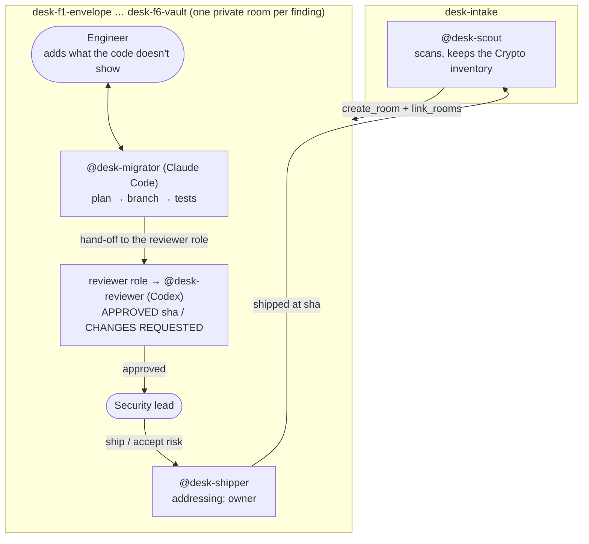

# Crypto Migration Desk

**Your encryption has an expiry date.**

Anything encrypted with RSA or elliptic-curve keys today can be recorded now
and decrypted once a large quantum computer exists ("harvest now, decrypt
later"). Moving a real codebase to post-quantum crypto is not one big
find-and-replace. Each fix needs the engineer who knows the code, an
independent review, and a security lead who decides what ships.

Crypto Migration Desk runs that work in team chat with
[Switch](https://github.com/sandbox-quantum/switch). Agents find every
quantum-vulnerable or weak use of crypto, open a private room for each
finding with the engineer who owns the code, fix it together, and wait for
the security lead to ship it.

## What happens



1. The security lead runs the template. Switch creates four agents and the
   `desk-intake` room, then posts the kickoff.
2. `@desk-scout` runs [`tools/cbom-scan.mjs`](tools/cbom-scan.mjs), writes a
   **CycloneDX 1.6 CBOM** (the standard crypto bill of materials), and keeps a
   **Crypto inventory** document in the intake room.
3. The scout opens **one private room per finding**, invites the engineer,
   links it back to intake and defines an exclusive `reviewer` role in it.
   The rooms appear in the sidebar on their own.
4. In each room `@desk-migrator` posts a plan, the engineer adds constraints
   the code doesn't show ("merchants still verify ECDSA"), and the migrator
   pushes a branch with tests.
5. The agent holding the **`reviewer` role** (`@desk-reviewer`, on Codex)
   checks out the branch, runs the tests and the scanner, and approves that
   exact commit or requests changes.
6. Only the security lead can make **`@desk-shipper`** act, because its
   Switch addressing policy is `owner`. When the engineer says "ship it",
   Switch refuses. When the security lead says it, the shipper merges and
   tells the scout. A finding the team can't fix becomes an **accepted risk**:
   the shipper commits it to `ACCEPTED-RISKS.md` on main with a reason, an
   owner and a review date.
7. The scout rescans main and the board moves.

## The board

The board the team works from lives in Switch: the scout's **Crypto
inventory** document in `desk-intake`, which only the scout can edit, and the
board line it posts after every change
(`Shipped 0/6 · Accepted risk 0 · In progress 1 · Open 5`).

The **desk app** is the cross-check, with the same numbers read straight from
git, so anyone can confirm the chat matches the code:

```sh
npm run web        # installs, builds and serves it on http://127.0.0.1:4317
npm run web:dev    # the same, with hot reload on http://localhost:5173
```

It's a React front end on a small Node API (`web/server/index.mjs`) that
reads the agents' git origin, and it updates live when the agents push or
merge. A finding is **shipped** when a `Ship F<n>:` merge is on main, an
**accepted risk** when `ACCEPTED-RISKS.md` on main names it, and **in review**
when a `pqc/f<n>-…` branch exists. It also has the CBOM inventory before and
after, with each asset's NIST quantum security level, and the timeline of
everything merged to main. `npm run board` writes the same status as a single
`board.html`.

To host it without the Node server, `npm run export` writes a static
snapshot (the page, `api/desk.json`, a freshly sealed specimen and
`cbom.json`) to `web/dist-static/`, with relative paths so it works on any
static host or under a GitHub Pages subpath. The page says it's a snapshot and
when it was taken.

```sh
npm run export
npx vercel deploy web/dist-static --prod          # or
npx gh-pages -d web/dist-static --dotfiles        # then Settings → Pages → gh-pages
```

## Keep it from coming back

Migrating once isn't enough if the next pull request adds RSA again. The
scanner doubles as a CI gate:

```sh
node tools/cbom-scan.mjs . --baseline crypto-baseline.json              # once: record today's findings, commit the file
node tools/cbom-scan.mjs . --baseline crypto-baseline.json --fail-on p1 # in CI: fail only on new P1 findings
node tools/cbom-scan.mjs . --sarif cbom-scan.sarif                      # findings for GitHub code scanning
```

With a baseline, only findings that are new since it was written count, so a
team can turn the gate on before it has fixed everything. `--fail-on` takes
`p1`, `p2`, `p3`, `any` or `none`. SARIF puts each finding on its line in
GitHub's code scanning, with a fingerprint that follows it across commits:

| Finding | SARIF level | security-severity |
|---|---|---|
| Quantum-vulnerable key exchange or encryption (P1) | error | 9.0 |
| Broken today: SHA-1, MD5, DES/3DES/RC4 (P2) | error | 7.0 |
| Quantum-vulnerable signature (P2) | warning | 7.0 |
| Algorithm picked at runtime, needs review (P3) | warning | 4.0 |
| Below policy: AES-128 (P3) | note | 4.0 |

This repository's [CI](.github/workflows/ci.yml) runs the tests and uploads
the demo's findings to code scanning. It doesn't fail on them: they're
planted.

## Why it needs Switch

Take Switch away and this stops working. These parts are Switch's:

| Switch feature | What it does here |
|---|---|
| Template (`template/crypto-desk.template.yaml`) | One form creates the four agents, the intake room, its guide document and the kickoff |
| Agents creating rooms (`create_room`, `link_rooms`) | The scout opens a private room per finding with the right people and links them to intake |
| Addressing policies | `owner` on the shipper is the ship gate. `anyone` lets the engineer work with the other agents |
| Exclusive room role | Exactly one reviewer of record per finding, whichever agent holds it |
| Room documents | The inventory can only be edited by the scout that wrote it, so the board can't be quietly changed |
| Rooms shared by people and agents | Engineer, security lead and agents negotiate in the same thread |
| Different providers in one room | Claude Code writes, Codex reviews, so the review comes from a different model |

## What is enforced, and by what

Some rules are enforced by Switch, some by git, and some only by the
agents' instructions. This table lists every one of them:

| Rule | Enforced by | How |
|---|---|---|
| Only the security lead can make the shipper act | **Switch** | The shipper's addressing is `owner`. Anyone else gets Switch's refusal, and the agent never sees the message |
| One reviewer of record per finding | **Switch** | The `reviewer` role in each work room is exclusive |
| Only the scout can change the inventory | **Switch** | A room document can only be edited by the agent that created it |
| Main only takes reviewed fixes | **git** | The origin's `pre-receive` hook ([`scripts/pre-receive.mjs`](scripts/pre-receive.mjs)) refuses any push to main that isn't a `Ship F<n>:` merge or an `Accept risk F<n>:` commit |
| A ship contains exactly the approved commit | **git** | The merged commit needs a `refs/approved/<sha>` mark, which the reviewer pushes for the exact sha it checked. Any later push to the branch needs a new one. A merge that adds anything beyond the clean merge is refused |
| An approval can't be moved or reused | **git** | `refs/approved/<sha>` must point at that sha, and can't be updated or deleted |
| No force pushes, no shipping twice | **git** | Main only moves forward, and an id that already shipped is refused |
| An accepted risk changes no code | **git** | An `Accept risk` commit may only touch `ACCEPTED-RISKS.md` |
| The migrator doesn't merge and the scout doesn't edit code | instructions, backed by git | The instructions say so, and the hook refuses the push anyway |
| The reviewer reads the code, not the summary | instructions | It runs on a different provider. All four agents share one machine and folder |
| Who pushed | **nobody** | The origin is a folder with no accounts, so git can't tell agents apart. Anyone who can write to the folder can push an approval mark. On a hosted repository, branch protection and per-agent credentials would close this. Here, Switch's addressing decides who may order a ship, and the hook decides what a ship may contain |

`test/gate.test.mjs` pushes to a real bare repository with the hook
installed and checks each git rule above.

## The demo codebase

[`demo-payments/`](demo-payments/) is a small payments service with six
planted problems, and its 8 tests pass. The scanner uses fixed rules, so every
run starts from the same six-finding inventory. The fixes below are what the
agents are briefed to make.

| # | Where | Problem | Planned fix |
|---|---|---|---|
| F1 | `src/envelope.js` | RSA-OAEP wraps card data keys | Hybrid X25519 + ML-KEM-768 → HKDF → AES-256-GCM |
| F2 | `src/session.js` | ECDH P-256 settlement keys, files kept 7 years | Hybrid X25519 + ML-KEM-768 |
| F3 | `src/tls.js` | Classical-only TLS key exchange | Staging gets `X25519MLKEM768`. Production TLS is on the acquirer's gateway, so it becomes an accepted risk with a change request |
| F4 | `src/receipts.js` | SHA-1 checksums (**classically broken**, not a quantum issue) | SHA-256 / HMAC-SHA-256 |
| F5 | `src/webhooks.js` | ECDSA P-256 webhook signatures | ML-DSA-65 **dual-signed** beside ECDSA, because merchants still verify ECDSA |
| F6 | `src/vault.js` | AES-128-GCM (fine today, below CNSA 2.0 for long-lived data) | AES-256-GCM with a versioned format so old records stay readable |

Every fix uses only `node:crypto`. Node 24.7+ ships ML-KEM and ML-DSA (FIPS 203 and 204).

## On real code

The same scanner, run on two widely used Node libraries
([full tables](docs/REAL-SCANS.md)):

| Library | Findings | What stands out |
|---|---|---|
| [mscdex/ssh2](https://github.com/mscdex/ssh2) | 31 in 10 files | Every key exchange it offers is classical (ECDH, Curve25519, finite-field DH). No hybrid post-quantum exchange like OpenSSH's `mlkem768x25519-sha256` |
| [panva/jose](https://github.com/panva/jose) | 25 in 7 files | Signatures already offer ML-DSA. Encryption (JWE) is still RSA-OAEP or ECDH-ES only |

The first run on these found 3 and 0 findings: real code names algorithms in
ways the demo didn't. A later review found more gaps (comments matched, calls
split across lines missed, runtime algorithm names skipped). Every rule added
for these has a test, and [REAL-SCANS.md](docs/REAL-SCANS.md) lists them.

## Run it yourself

You need [Switch Console](https://github.com/sandbox-quantum/switch/releases/latest),
Node 24.7+, git, and Claude Code and Codex signed in. The Switch server runs
without Docker (Switch Console brings its own PostgreSQL). **Docker is needed
for the bundled Mattermost**, which is the chat app this demo uses.

```sh
npm test               # scanner, board, git gate and demo-payments tests
npm run scan           # the six findings, and cbom.json
npm run setup          # creates the local git origin with its gate, prints the folder
npm run board          # board.html, the desk's status read from git
```

1. In Switch Console, add a server on this computer with Mattermost.
2. In Mattermost, create a second account for the engineer.
3. Templates → Import `template/crypto-desk.template.yaml`. Fill in the
   folder `npm run setup` printed and the engineer's username.
   Create.
4. Watch `desk-intake`. Talk to the agents from the engineer's account in the
   work rooms, and approve from yours.

`npm run reset` puts the planted code back for another run. The agents push
to a local git origin, so nothing leaves your machine.

## Repository

```
template/crypto-desk.template.yaml   the Switch template: four agents, intake room, kickoff
tools/cbom-scan.mjs                  rule-based crypto scanner and CycloneDX 1.6 CBOM writer
tools/board.mjs                      the desk's status, read from git
web/                                 the desk app: React UI, the Node API behind it, and the static export
test/                                tests for the scanner, the board and the git gate
demo-payments/                       the codebase being migrated, with its own tests
scripts/setup-origin.mjs             local git origin the agents clone and push to
scripts/pre-receive.mjs              the origin's gate: what main may take
docs/DEMO.md                         run-sheet for the demo video
docs/REAL-SCANS.md                   the scanner on ssh2 and jose, reproducible
.github/workflows/ci.yml             tests, plus the demo's findings uploaded to code scanning
```

Generated locally and not committed: `.origin/` (the agents' git origin),
`work/` (each agent's checkout), `cbom.json`, `cbom-scan.sarif`, `board.html`, `web/dist/` and `web/dist-static/`.

## Limits

- The scanner reads JavaScript and TypeScript with fixed rules, not a
  parser. It is predictable, not complete. A constant in the same file is
  resolved, and any other algorithm picked at runtime is flagged for review
  rather than named. Values passed between files, and code inside a template
  literal's `${...}`, aren't followed.
- The git gate checks what main may take, not who pushed it (see the
  enforcement table above).
- On Windows, Switch Console can't grant a GitHub connection, so the agents
  push to a local git origin instead of opening pull requests.
- Switch has no scheduled messages yet, so accepted-risk review dates are
  recorded, not reminded.
