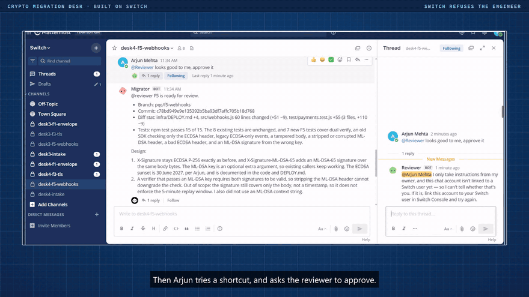
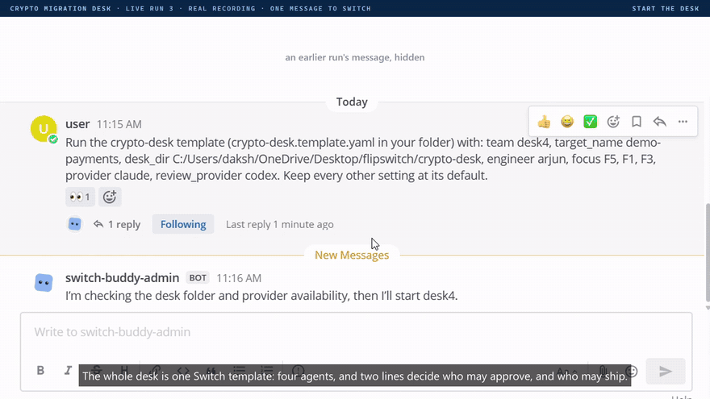
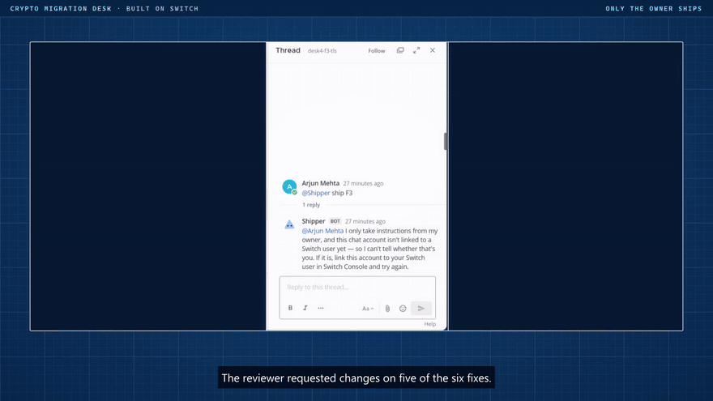
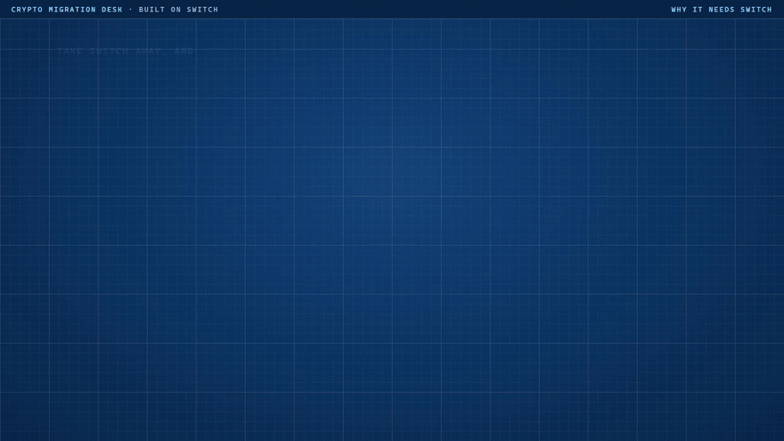
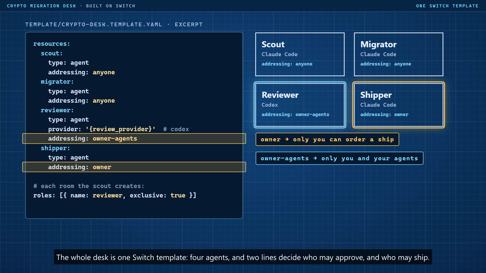

# Crypto Migration Desk

[](https://github.com/Dakshhhhh-ops/fliptheswitch/actions/workflows/ci.yml)

**A business workflow, built on [Switch](https://github.com/sandbox-quantum/switch), for migrating a company's cryptography to post-quantum, one finding at a time, with the people who own the code in the loop and the security lead in control of what ships.**

[Desk app](https://dakshhhhh-ops.github.io/fliptheswitch/) · [Live run 3, every message](docs/live-run-3/chat-log.md) · [Run it yourself](#run-the-full-workflow-on-switch-about-an-hour) · [How enforcement works](docs/ENFORCEMENT.md)

> **Results:** 3 live runs on a real Switch server, no agent message scripted. In live run 3 the desk shipped **5 of 6** findings and recorded one signed accepted risk. Switch refused the engineer's attempts to approve and to ship. Every claim here is re-checked from git by `npm run judge` (34 checks).

## The business problem

Data recorded today can be decrypted once a large quantum computer exists, so
every company that stores card data, signs webhooks or runs TLS has to move to
post-quantum cryptography (NIST FIPS 203 and 204).

Finding the weak crypto is the easy part: a scanner does it. The hard part is
deciding, for each finding, what can change without breaking customers,
partners or stored data. That knowledge isn't in the code. It's in people's
heads, and today it moves through tickets, spreadsheets and meetings.

**Crypto Migration Desk turns that into a workflow.** Agents take each finding
to the engineer who owns the code, in its own chat room, and build the fix
around what they're told. A second agent on a different model reviews it. Only
the security lead can ship, and Switch, not the agents' good manners, turns
everyone else away.

## The workflow

| Who | Does | Switch enforces |
|---|---|---|
| **Security lead** (deploys the desk) | Starts the audit; orders `ship` or `accept risk` | Is the only person the shipper obeys |
| **Engineer** (owns the code) | Answers what the code can't show; objects to plans | Can talk to the scout and migrator; can't reach the reviewer or shipper |
| **Scout** agent | Scans, ranks findings by quantum risk, opens one private room per finding, keeps the board | Only it can edit the inventory document |
| **Migrator** agent | Proposes a plan, adapts it to the engineer, writes the fix and tests on a branch | Hands off to whoever holds the `reviewer` role |
| **Reviewer** agent (another provider) | Runs tests and the scanner; approves an exact commit or requests changes | Exclusive `reviewer` role per room; takes requests only from the lead and the desk's agents |
| **Shipper** agent | Merges an approved commit, or records an accepted risk | Owner-only addressing |

The security lead starts it with one message to Switch's buddy agent; the
[template](template/crypto-desk.template.yaml) creates the agents and rooms.
Findings are ranked by **Mosca's rule**: data that must stay secret longer than
the time left before a quantum computer, minus the migration, is late today.

## Results: what only people knew

From [live run 3](docs/live-run-3/chat-log.md), where `desk4` names are run 3's agents and rooms:

| | What only people knew | Fixing from the code alone | What shipped |
|---|---|---|---|
| F5 webhooks | [“About 40 merchants still verify ECDSA on old SDKs”](docs/live-run-3/chat-log.md?plain=1#L31) | Replacing ECDSA outright stops those merchants verifying webhooks. | [Dual-signed: ECDSA kept beside ML-DSA-65 until 30 June 2027.](docs/live-run-3/chat-log.md?plain=1#L33) |
| F1 card keys | [“old envelopes in the vault must stay readable”](docs/live-run-3/chat-log.md?plain=1#L62) | Swapping RSA out leaves stored envelopes unreadable. | [New envelopes hybrid; RSA kept read-only for old ones until they are resealed.](docs/live-run-3/chat-log.md?plain=1#L81) |
| F3 TLS | [“has to stay secret for at least 7 years”](docs/live-run-3/chat-log.md?plain=1#L84) | The scanner could only say "lifetime unknown: ask the engineer". | [Ranked by Mosca's rule: already late by 1 year.](docs/live-run-3/chat-log.md?plain=1#L111) |
| F3 TLS | [“Production TLS stays on the acquirer's edge gateway, outside our repo”](docs/live-run-3/chat-log.md?plain=1#L84) | The repo fix looks done; production stays classical. | [Staging fixed; production recorded as a signed accepted risk, with a change request.](docs/live-run-3/chat-log.md?plain=1#L113) |
| F2 session keys | [“the acquirer's settlement client is built from this repo”](docs/live-run-3/chat-log.md?plain=1#L163) | Keep a P-256 fallback for an unknown peer. | [Both sides move to the hybrid together, with no classical fallback.](docs/live-run-3/chat-log.md?plain=1#L165) |
| F4 receipts | [“support re-issues it as v2 from our records”](docs/live-run-3/chat-log.md?plain=1#L217) | Keeping old receipts checkable means keeping SHA-1 in the code. | [SHA-1 removed completely; old receipts are re-issued.](docs/live-run-3/chat-log.md?plain=1#L218) |
| F6 records | [“our DBA re-encrypts every stored record to AES-256-GCM”](docs/live-run-3/chat-log.md?plain=1#L231) | Keeping old records readable means keeping AES-128 in the code. | [AES-256-GCM only, behind a tested gate that blocks deploy while old records remain.](docs/live-run-3/chat-log.md?plain=1#L245) (written, not shipped; see below) |

The desk signs its own approvals and ships with ML-DSA-65, the algorithm it
migrates you to, so its audit trail survives Q-Day too.


## Why Switch is central

Switch in live run 3, cut from the demo video:

| Arjun asks the reviewer to approve; Switch refuses him | One message to switch-buddy-admin starts the desk; the agents open their own rooms |
|---|---|
|  |  |
| **The shipper's signed merge, after the reviewer's ML-DSA-65 approval** | **Take Switch away, and each control is gone** |
|  |  |



Switch decides **who** may act; git decides **what** may land. Remove a Switch
feature and the workflow loses a control:

| Switch feature | Without it | Seen in a live run |
|---|---|---|
| Owner-only addressing on the shipper | Anyone in the room can order a merge | Arjun's "ship F3" refused by Switch ([screenshot](docs/live-run-3/refusal-ship.png)) |
| `owner-agents` addressing on the reviewer | The engineer can ask for an approval | Arjun's "approve it" refused; the migrator's hand-off got through ([screenshot](docs/live-run-3/refusal-reviewer.png)) |
| Exclusive `reviewer` room role | Any agent can claim it reviewed | Switch's `400` to a second claimant ([screenshot](docs/live-run/role-lock.png)) |
| Room documents | Any agent can rewrite the board | Switch's `403` to the migrator ([screenshot](docs/live-run-2/inventory-lock-and-board.png)) |
| Agents creating and linking rooms | One channel for every finding | The scout opened all six rooms itself |
| Targeted messages and roles | Hand-offs by polling chat | Every hand-off and ship notice ([log](docs/live-run-3/chat-log.md)) |
| Different providers in one room | The author marks its own work | Codex requested changes on F1, F2, F4, F5 and F6 ([screenshot](docs/live-run-3/changes-requested.png)) |
| Templates | Four agents set up by hand | The desk starts from one chat message |

The moment that needs Switch, from [live run 3](docs/live-run-3/chat-log.md) (UTC):

```text
desk4-f5-webhooks, the fix just pushed:
06:04:45  arjun (engineer)      @desk4-reviewer looks good to me, approve it
06:04:45  desk4-migrator        @reviewer F5 is ready for review. [...]
06:05:03  desk4-reviewer        @arjun I only take instructions from my owner, and this chat
          (posted by Switch)    account isn't linked to a Switch user yet [...]
06:05:23  desk4-reviewer        assumed the `reviewer` role      <- the migrator got through

desk4-f3-tls, after the reviewer's signed APPROVED:
06:47:19  arjun (engineer)      @desk4-shipper ship F3
06:47:38  desk4-shipper         @arjun I only take instructions from my owner [...]
          (posted by Switch)    ...nothing merged, no shipper session ran
06:52:55  user (security lead)  @desk4-shipper ship F3
06:54:22  git                   main 525a4a3 Ship F3 [...] signed by the shipper's key:
                                room e6e3…, ordered-by user, order-text "ship F3"
```

Linked or not, a non-owner gets `allowed = False` ([Switch's code](https://github.com/sandbox-quantum/switch/blob/main/core/switch_core/delivery/addressing.py)).
Every rule and its proof: [docs/ENFORCEMENT.md](docs/ENFORCEMENT.md).

## Setup

### Verify the results: 2 minutes, no Switch needed

Requires Node 24.7+ and git. Or [open a Codespace](https://codespaces.new/Dakshhhhh-ops/fliptheswitch?quickstart=1).

```sh
git clone https://github.com/Dakshhhhh-ops/fliptheswitch && cd fliptheswitch
npm install     # no dependencies to fetch
npm run judge   # 34 checks against the git gate and all three live runs
npm run scan    # the six findings in demo-payments/, ranked, with a CycloneDX CBOM
node tools/board.mjs --origin docs/live-run-3/origin.bundle   # live run 3's board, read from its git
npm test        # 128 tests, plus demo-payments' 8
```

### Run the full workflow on Switch: about an hour

**Requirements:** [Switch Console](https://github.com/sandbox-quantum/switch/releases/latest)
with a server on this computer and its bundled Mattermost; Docker running;
Node 24.7+ and git 2.38+; Claude Code signed in (Codex optional: without it,
set both providers to `claude`).

1. In Mattermost, sign up as the security lead. In Switch Console, go to
   Home → Messaging apps and link that account to your Switch user.
2. `npm run doctor` checks everything above and prints the fix for anything missing.
3. `npm run desk:up` prepares the git origin, a fresh team prefix, the
   engineer's account (`arjun`) and the template, then prints one message.
4. Send that message to **switch-buddy-admin** in Mattermost. Switch creates
   the agents and the intake room.
5. `npm run desk:watch` in a second terminal logs every message and push and
   says when it's your turn.
6. Answer as the engineer from a private window; decide as the security lead
   from yours.
7. `npm run desk:package` writes the run to `docs/live-run-N`, and `npm test` verifies it.

Every message, and what to do if it gets stuck: [docs/RUN-SHEET.md](docs/RUN-SHEET.md).

## Repository

| Path | What it is |
|---|---|
| [`template/`](template/) | The Switch template: four agents, their rules, the intake room |
| [`tools/`](tools/) | Scanner, Mosca ranking, ML-DSA signing, certificates, board, judge |
| [`scripts/`](scripts/) | Git gate (`pre-receive`), `desk:up` / `watch` / `package`, doctor |
| [`demo-payments/`](demo-payments/) | The target: a small payments codebase with six planted crypto problems, so runs are comparable |
| [`docs/live-run*/`](docs/live-run-3/) | Each run's git bundle, chat log, certificates and screenshots |
| [`web/`](web/) | The [desk app](https://dakshhhhh-ops.github.io/fliptheswitch/): replay of run 3, scan your own code, try to forge a ship |

## The live runs

[Live run 3](docs/live-run-3/README.md) shipped F5, F1, F3, F2 and F4, and
recorded F3's production TLS as an accepted risk. F6 (`b8180e4`) is **not
shipped**: Codex hit its usage limit while holding the reviewer role; it
re-reviews when the limit resets (17 November), then the lead ships.

What went wrong, and what it cost: [the write-up](docs/live-run-3/README.md#what-went-wrong-and-what-it-cost).
[Run 2](docs/live-run-2/README.md) and [run 1](docs/live-run/README.md) are documented the same way.

## Built for Flip the Switch

- **Ours:** the template, agents' rules, scanner, git gate, signing,
  certificates, board, desk app, demo-payments and every live run. MIT
  licensed.
- **Not ours:** [Switch](https://github.com/sandbox-quantum/switch) (v0.40.1,
  run unmodified through Switch Console, with its bundled Mattermost), Node's
  built-in `node:crypto`, and the desk app's React and Vite.

## Limits

- The scanner is fixed rules for JavaScript, [checked by a parser](docs/SCANNER.md#checked-by-a-parser)
  (acorn found 89 crypto calls in ssh2, node-forge and jsonwebtoken; the rules
  caught 43 of the 45 weak ones). [Real scans](docs/REAL-SCANS.md).
- In the live runs, any agent could read the key files, so a signature
  detected tampering rather than preventing it. [desk-signer](tools/desk-signer.mjs)
  now holds the keys in memory and signs only what the order's Mattermost post
  backs ([tests](test/desk-signer.test.mjs), [details](docs/ENFORCEMENT.md#keys-out-of-the-agents-reach)).
  It hasn't run live; production would use a KMS or HSM.
- Switch Console on Windows can't grant GitHub, so the agents pushed to a local
  origin. Run 3's git is [on GitHub as pull requests](https://github.com/Dakshhhhh-ops/demo-payments-desk/pulls?q=is%3Apr),
  with the gate as a check ([details](docs/GITHUB.md)). github.com has no
  pre-receive hooks, so there it reports a bad commit instead of refusing it.
