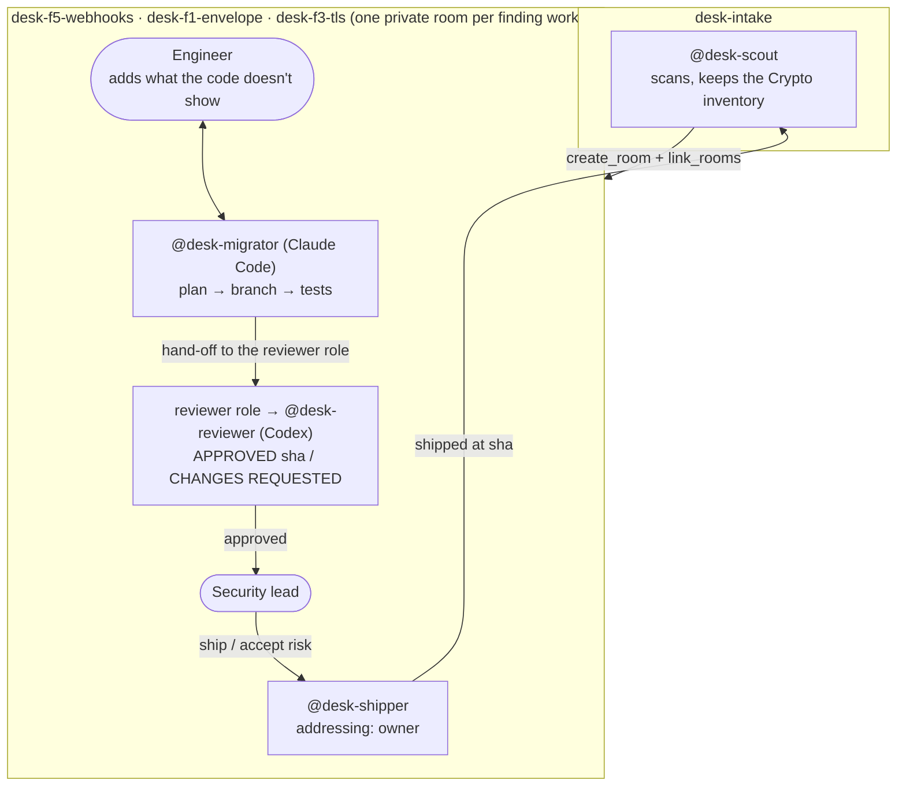

# Crypto Migration Desk

[](https://github.com/Dakshhhhh-ops/fliptheswitch/actions/workflows/ci.yml)

**Your encryption has an expiry date. Some of it is already past it.**

**[Open the desk app](https://dakshhhhh-ops.github.io/fliptheswitch/)** (a snapshot of live run 1) · [Judge it in 90 seconds](#judge-it-in-90-seconds) · [Scan your own code](#scan-your-own-code-in-10-seconds) · [What it found in ssh2 and jose](docs/REAL-SCANS.md) · [What is enforced, and how it's proved](#what-is-enforced-and-how-its-proved) · [Run it in Switch](#run-it-yourself)

Today, [ssh2](https://github.com/mscdex/ssh2), one of npm's most used SSH
libraries, offers only classical key exchange: 31 findings in 10 files. Data
sent over it can be recorded now and decrypted once a large quantum computer
exists ("harvest now, decrypt later"). For data that must stay secret for
years, that is a problem today, not in 2035. That's Mosca's rule, and this
desk ranks every finding by it.

Crypto Migration Desk runs the migration in team chat with
[Switch](https://github.com/sandbox-quantum/switch). A scout agent finds
every quantum-vulnerable or weak use of crypto and opens a private room for
each finding being worked, with the engineer who owns the code. A migrator
writes the fix, a reviewer on a different model approves the exact commit,
and only the security lead can make the shipper merge it. Switch refuses
anyone else, and git refuses anything unreviewed.

## Judge it in 90 seconds

> 1. **The agents in Switch:** [the live runs](docs/live-run-2/README.md), with
>    screenshots. Switch decided who could order a ship, held the one
>    reviewer role, locked the inventory to the scout, and carried the
>    negotiation between the engineer, the security lead and four agents.
>    [Run it yourself](#run-it-yourself) to repeat it.
> 2. **Check it yourself, with nothing to install:** `npm run judge` (Node
>    24.7+). 24 checks in about a minute. It replays the agents' git
>    moves against the real gate, scanner and tests: a post-quantum fix for
>    F5, every shortcut refused (straight to main, unapproved, changed after
>    approval, shipped twice, a "risk" that edits code), the approved ship
>    accepted, and a signed certificate that fails once one sha in it is
>    changed or it's re-signed with another key. Then it checks **both live
>    Switch runs** from the git history the agents left: their certificates,
>    every push replayed through the gate, and the board. The replayed moves are scripted; what Switch
>    refused is in the screenshots, because that can't be shown without Switch.
> 3. **On your code:** `node tools/cbom-scan.mjs <your-repo>`, below.

## Live run results

The desk has been run end to end in Switch twice, with nothing scripted.
Each run's write-up, screenshots, certificates and the agents' git history
are in the repository.

**[Live run 2](docs/live-run-2/README.md)** (`desk3`, 6 November 2026):
**Shipped 3/6 (F3 with a risk on record) · Open 3**: F3's staging fix shipped, and its production TLS, on the acquirer's gateway, is an accepted risk.

- **F5 shipped** (`90d83ac`): dual-signed with ECDSA and ML-DSA-65, because
  Arjun said 40 merchants still verify ECDSA. Approved first time.
- **F1 shipped** (`947f2c2`): hybrid X25519 + ML-KEM-768 with a read-only RSA
  path for old envelopes. Codex **requested changes** (the commit didn't say
  when RSA retires), the migrator fixed it, and Codex approved, with no
  person involved.
- **F3 shipped** (`a343979`) for staging, and its production TLS, on the
  acquirer's gateway, recorded as an accepted risk (`374c45f`).
- People sent only answers and decisions: 3 answers from the engineer, 4
  decisions from the security lead, no nudges. One retry after Codex's
  sandbox stalled on Windows ([what happened](docs/live-run-2/README.md#what-went-wrong-and-what-changed-because-of-it)).
- Switch refused the engineer's "ship F3" [before any agent ran](docs/live-run-2/refusal-ship.png),
  and refused the migrator's edit to the scout's inventory with a
  [`403`](docs/live-run-2/inventory-lock-and-board.png).

**[Live run 1](docs/live-run/README.md)** (`desk2`, 5–6 November 2026):
Shipped 2/6 · Accepted risk 1. It also caught Switch's `400` when a second
agent tried to take the [reviewer role](docs/live-run/role-lock.png). What
went wrong in it changed the template that run 2 used.

Check any run from git, with nothing but Node:

```sh
node tools/replay.mjs docs/live-run-2/origin.bundle                   # every push, replayed through the gate
node tools/certificate.mjs verify docs/live-run-2/F1.cert.json --tests # signer, every sha, and the tests at the merge
```

## Scan your own code in 10 seconds

No Switch, no install, no dependencies:

```sh
git clone https://github.com/Dakshhhhh-ops/fliptheswitch && cd fliptheswitch
node tools/cbom-scan.mjs ../your-repo --out cbom.json
```

On the demo service it prints:

| # | Priority | Where | Algorithm | Mosca |
|---|---|---|---|---|
| F1 | P1 | `src/envelope.js:15` | RSA-OAEP (2048) | Already late: kept for the life of the customer account (from `infra/DEPLOY.md`) |
| F2 | P1 | `src/session.js:7` | ECDH (P-256) | Already late by 1 year (7 + 3 vs 9 years, from `infra/DEPLOY.md`) |
| F3 | P1 | `src/tls.js:6` | TLS classical key exchange | Lifetime unknown: ask the engineer |
| F4 | P2 | `src/receipts.js:17` | SHA-1 | Late now: broken today, no quantum computer needed |
| F5 | P2 | `src/webhooks.js:7` | ECDSA (P-256) | On time: 6 years to spare |
| F6 | P3 | `src/vault.js:14` | AES-128-GCM | Not on Mosca's clock: Grover only halves its strength |

**Mosca's rule:** if (how long the data must stay secret) + (how long the
migration takes) > (years until a quantum computer), you are already late.
The lifetime comes from the code itself: a comment in the file, or a doc line
that names the file ("kept for 7 years"). When nothing says, the verdict is
"ask the engineer", never a guess. Migration time (3 years) and Q-Day (2035,
NIST's planned disallow date, which is a planning date, not a prediction) are
stated assumptions, and `--migration-years` and `--qday-year` change them.

The scanner also writes a CycloneDX 1.6 CBOM (`--out`), SARIF for GitHub
code scanning (`--sarif`), and works as a CI gate (`--fail-on p1`,
[below](#keep-it-from-coming-back)).

## What happens



1. The security lead runs the template. Switch creates four agents and the
   `desk-intake` room, then posts the kickoff.
2. `@desk-scout` runs [`tools/cbom-scan.mjs`](tools/cbom-scan.mjs), writes a
   **CycloneDX 1.6 CBOM** (the standard crypto bill of materials), and keeps a
   **Crypto inventory** document in the intake room.
3. The scout opens **one private room per finding**, invites the engineer,
   links it back to intake and defines an exclusive `reviewer` role in it.
   The rooms appear in the sidebar on their own.
4. In each room `@desk-migrator` posts a plan, the engineer adds constraints
   the code doesn't show ("merchants still verify ECDSA"), and the migrator
   pushes a branch with tests.
5. The agent holding the **`reviewer` role** (`@desk-reviewer`, on Codex)
   checks out the branch, runs the tests and the scanner, and approves that
   exact commit or requests changes.
6. Only the security lead can make **`@desk-shipper`** act, because its
   Switch addressing policy is `owner`. When the engineer says "ship it",
   Switch refuses. When the security lead says it, the shipper merges and
   tells the scout. A finding the team can't fix becomes an **accepted risk**:
   the shipper commits it to `ACCEPTED-RISKS.md` on main with a reason, an
   owner and a review date.
7. The scout rescans main and the board moves.

## The board

The board the team works from lives in Switch: the scout's **Crypto
inventory** document in `desk-intake`, which only the scout can edit, and the
board line it posts after every change
(`Shipped 0/6 · Accepted risk 0 · In progress 1 · Open 5`).

The **desk app** is the cross-check, with the same numbers read straight from
git, so anyone can confirm the chat matches the code:

```sh
npm run web        # installs, builds and serves it on http://127.0.0.1:4317
npm run web:dev    # the same, with hot reload on http://localhost:5173
```

It's a React front end on a small Node API (`web/server/index.mjs`) that
reads the agents' git origin, and it updates live when the agents push or
merge. A finding is **shipped** when a `Ship F<n>:` merge is on main, an
**accepted risk** when `ACCEPTED-RISKS.md` on main names it, and **in review**
when a `pqc/f<n>-…` branch exists. It also has the CBOM inventory before and
after, with each asset's NIST quantum security level, and the timeline of
everything merged to main. `npm run board` writes the same status as a single
`board.html`.

To host it without the Node server, `npm run export` writes a static
snapshot (the page, `api/desk.json`, a freshly sealed specimen and
`cbom.json`) to `web/dist-static/`, with relative paths so it works on any
static host or under a GitHub Pages subpath. The page says it's a snapshot and
when it was taken.

```sh
npm run export
npx vercel deploy web/dist-static --prod          # or
npx gh-pages -d web/dist-static --dotfiles        # then Settings → Pages → gh-pages
```

## Keep it from coming back

Migrating once isn't enough if the next pull request adds RSA again. The
scanner doubles as a CI gate:

```sh
node tools/cbom-scan.mjs . --baseline crypto-baseline.json              # once: record today's findings, commit the file
node tools/cbom-scan.mjs . --baseline crypto-baseline.json --fail-on p1 # in CI: fail only on new P1 findings
node tools/cbom-scan.mjs . --sarif cbom-scan.sarif                      # findings for GitHub code scanning
```

With a baseline, only findings that are new since it was written count, so a
team can turn the gate on before it has fixed everything. `--fail-on` takes
`p1`, `p2`, `p3`, `any` or `none`. SARIF puts each finding on its line in
GitHub's code scanning, with a fingerprint that follows it across commits:

| Finding | SARIF level | security-severity |
|---|---|---|
| Quantum-vulnerable key exchange or encryption (P1) | error | 9.0 |
| Broken today: SHA-1, MD5, DES/3DES/RC4 (P2) | error | 7.0 |
| Quantum-vulnerable signature (P2) | warning | 7.0 |
| Algorithm picked at runtime, needs review (P3) | warning | 4.0 |
| Below policy: AES-128 (P3) | note | 4.0 |
| Kept on purpose beside its post-quantum replacement: legacy read path or dual signature (P3) | note | 4.0 |

This repository's [CI](.github/workflows/ci.yml) runs the tests, the judge
and the live-run certificate checks on Linux, Windows and macOS, builds and
exports the desk app, and uploads the demo's findings to code scanning. It
doesn't fail on the findings: they're planted.

## Why it needs Switch

Take Switch away and this stops working. These parts are Switch's:

| Switch feature | What it does here | Without it | In the live run |
|---|---|---|---|
| Template (`template/crypto-desk.template.yaml`) | One form creates the four agents, the intake room, its guide document and the kickoff | Four agents and their rules set up by hand, per team | Run from a chat message to Switch's buddy agent |
| Agents creating rooms (`create_room`, `link_rooms`) | The scout opens a private room per finding with the right people and links them to intake | One shared channel for every finding, or a person making rooms | The scout opened the F5, F1 and F3 rooms and started F1 on its own |
| Addressing policies | `owner` on the shipper is the ship gate. `owner-agents` on the reviewer means only the security lead and the desk's agents can ask it for a verdict. `anyone` on the scout and migrator lets the engineer steer the fix | Any agent obeys anyone who can type in the room, so the engineer could ask the reviewer to approve | Arjun's "ship F1" and "accept risk" refused before an agent ran ([screenshot](docs/live-run/refusal-ship.png)) |
| Exclusive room role | Exactly one reviewer of record per finding, whichever agent holds it | Any agent can claim it reviewed | The migrator's `assume_role("reviewer")` got Switch's `400` ([screenshot](docs/live-run/role-lock.png)) |
| Room documents | The inventory can only be edited by the scout that wrote it, so the board can't be quietly changed | Any agent can rewrite the inventory | The migrator's edit got Switch's `403` ([screenshot](docs/live-run/inventory-lock.png)) |
| Targeted messages (`send_targeted_message`, `target_roles`) | Hand-offs go to whoever holds the reviewer role, and the shipper tells the scout what shipped | Agents polling chat for their name | The migrator handed each fix to the reviewer role, or by name when nobody held it; the shipper told the scout, and the scout updated the board after each ship |
| Rooms shared by people and agents | Engineer, security lead and agents negotiate in the same thread | Constraints relayed by hand between tools | Arjun's ECDSA and legacy-read constraints changed both fixes |
| Different providers in one room | Claude Code writes, Codex reviews, so the review comes from a different model | The author marks its own work | Codex requested changes on F1 before approving ([screenshot](docs/live-run/review-changes-requested.png)) |

## What is enforced, and how it's proved

Some rules are enforced by Switch, some by git, and some only by the
agents' instructions. This table lists every one of them, and what proves it:

| Rule | Enforced by | How | Proved by |
|---|---|---|---|
| Only the security lead can make the shipper act | **Switch** | The shipper's addressing is `owner`. Switch answers anyone else itself, before an agent session starts | Live run, for an unlinked engineer: Switch refused Arjun's "ship F1" and "accept risk" with no agent session ([1](docs/live-run/refusal-ship.png), [2](docs/live-run/refusal-accept-risk.png)). An unlinked account [matches nobody, not the owner](https://github.com/sandbox-quantum/switch/blob/main/docs/official/internals/identity-and-access.md#identity-claims), so the owner rule turns it away; Switch words that case as "isn't linked" ([source](https://github.com/sandbox-quantum/switch/blob/main/core/switch_core/delivery/addressing.py)). **Not shown:** a linked non-owner, which needs a second Switch user (this server has one, sign-up off) |
| One reviewer of record per finding | **Switch**, and checked by the shipper | Switch keeps the `reviewer` role in each work room exclusive. The shipper only ships a verdict from the agent holding it | The shipper's check: live run, it refused F1 while nobody held the role ([screenshot](docs/live-run/one-reviewer-of-record.png)). Switch itself: live run, the migrator's `assume_role("reviewer")` got `400: Role 'reviewer' is exclusive and currently held by another agent` ([screenshot](docs/live-run/role-lock.png)) |
| Only the desk can ask the reviewer for a verdict | **Switch** | The reviewer's addressing is `owner-agents`: the security lead and agents the lead owns (the migrator's hand-off) get through. Switch refuses the engineer before a reviewer session starts, so nobody can talk it into an approval | Template test "Switch addressing: only the desk asks the reviewer, only the lead orders a ship". **Not shown live yet:** both live runs ran with the reviewer on `anyone` |
| Only the scout can change the inventory | **Switch** | A room document can only be edited by the agent that created it | Live run: the migrator's `update_room_document` on the inventory got Switch's `403: Agent … did not create document …`, and the inventory was unchanged ([screenshot](docs/live-run/inventory-lock.png)) |
| Main only takes reviewed fixes | **git** | The origin's `pre-receive` hook ([`scripts/pre-receive.mjs`](scripts/pre-receive.mjs)) refuses any push to main that isn't a `Ship F<n>:` merge or an `Accept risk F<n>:` commit | `npm run judge` step 3; gate test "direct commits to main and force pushes are refused" |
| A ship contains exactly the approved commit | **git** | The merged commit needs a `refs/approved/<sha>` mark, which the reviewer pushes for the exact sha it checked. Any later push to the branch needs a new one. A merge that adds anything beyond the clean merge is refused | judge steps 3–4; gate tests "a fix without an approval does not ship", "an approval covers only that commit", "a ship merge that adds unreviewed changes is refused" |
| An approval can't be moved or reused | **git** | `refs/approved/<sha>` must point at that sha, and can't be updated or deleted | gate test "an approval cannot be moved, or point at a different commit" |
| No force pushes, no shipping twice | **git** | Main only moves forward, and an id that already shipped is refused | judge step 5; gate tests "a finding cannot ship twice", "direct commits to main and force pushes are refused" |
| An accepted risk changes no code | **git** | An `Accept risk` commit may only touch `ACCEPTED-RISKS.md` | judge step 6; gate test "an accepted risk may change only ACCEPTED-RISKS.md" |
| The migrator doesn't merge and the scout doesn't edit code | instructions, backed by git | The instructions say so, and the hook refuses the push anyway | the gate tests above |
| The reviewer reads the code, not the summary | instructions | It runs on a different provider. All four agents share one machine and folder | nothing automatic: read its review in the room |
| Who pushed | **nobody** | The origin is a folder with no accounts, so git can't tell agents apart. Anyone who can write to the folder can push an approval mark. On a hosted repository, branch protection and per-agent credentials would close this. Here, Switch's addressing decides who may order a ship, and the hook decides what a ship may contain | nothing: a stated limit |

`test/gate.test.mjs` and `npm run judge` push to a real bare repository with
the hook installed. Every ship also gets a migration certificate
([`tools/certificate.mjs`](tools/certificate.mjs)): the crypto in the file
before and after, the approved sha and its mark, the merge, and the tests at
it. It is read from git and signed with ML-DSA-65, the signature the desk
itself recommends. `certificate.mjs verify` checks that the signature is the
desk's key (not just whatever key the certificate carries), then checks every
claim in it against git: the merge is on main and merges exactly the approved
commit, the approval mark points at it, and the scanner sees the same crypto
before and after. `--tests` reruns the tests at the merge.

## The demo codebase

[`demo-payments/`](demo-payments/) is a small payments service with six
planted problems, and its 8 tests pass. The scanner uses fixed rules, so every
run starts from the same six-finding inventory. The fixes below are what the
agents are briefed to make.

| # | Where | Problem | Planned fix |
|---|---|---|---|
| F1 | `src/envelope.js` | RSA-OAEP wraps card data keys | Hybrid X25519 + ML-KEM-768 → HKDF → AES-256-GCM |
| F2 | `src/session.js` | ECDH P-256 settlement keys, files kept 7 years | Hybrid X25519 + ML-KEM-768 |
| F3 | `src/tls.js` | Classical-only TLS key exchange | Staging gets `X25519MLKEM768`. Production TLS is on the acquirer's gateway, so it becomes an accepted risk with a change request |
| F4 | `src/receipts.js` | SHA-1 checksums (**classically broken**, not a quantum issue) | SHA-256 / HMAC-SHA-256 |
| F5 | `src/webhooks.js` | ECDSA P-256 webhook signatures | ML-DSA-65 **dual-signed** beside ECDSA, because merchants still verify ECDSA |
| F6 | `src/vault.js` | AES-128-GCM (fine today, below CNSA 2.0 for long-lived data) | AES-256-GCM with a versioned format so old records stay readable |

Every fix uses only `node:crypto`. Node 24.7+ ships ML-KEM and ML-DSA (FIPS 203 and 204).

## On real code

The same scanner, run on two widely used Node libraries
([full tables](docs/REAL-SCANS.md)):

| Library | Findings | What stands out |
|---|---|---|
| [mscdex/ssh2](https://github.com/mscdex/ssh2) | 31 in 10 files | Every key exchange it offers is classical (ECDH, Curve25519, finite-field DH). No hybrid post-quantum exchange like OpenSSH's `mlkem768x25519-sha256` |
| [panva/jose](https://github.com/panva/jose) | 25 in 7 files | Signatures already offer ML-DSA. Encryption (JWE) is still RSA-OAEP or ECDH-ES only |

The first run on these found 3 and 0 findings: real code names algorithms in
ways the demo didn't. A later review found more gaps (comments matched, calls
split across lines missed, runtime algorithm names skipped). Every rule added
for these has a test, and [REAL-SCANS.md](docs/REAL-SCANS.md) lists them.

**How accurate is it?** `node tools/scanner-bench.mjs` scores it against 53
labelled lines of real-world crypto code ([test/fixtures/scanner-bench](test/fixtures/scanner-bench/)):
Node's crypto, Web Crypto, JOSE, node-forge, node-rsa, tweetnacl and elliptic,
plus decoys (comments, docs strings, modern algorithms) and code whose
algorithm is only known at runtime. **Precision 100%, recall 94%** (33 of 35).
The two misses are listed as known gaps: an algorithm passed through your own
wrapper function, and a standalone X25519 in a file that also does the
hybrid. `npm test` fails if precision drops, recall falls under 90%, or a new
miss appears.

## Run it yourself

Every step that doesn't need a person is a command. The full run, with every
message to send and what to do if it gets stuck: [docs/RUN-SHEET.md](docs/RUN-SHEET.md).

You need [Switch Console](https://github.com/sandbox-quantum/switch/releases/latest)
with its Mattermost (which needs Docker), Node 24.7+, git 2.38+ and Claude
Code. Codex is optional: without it the reviewer runs on Claude, as its own
agent with its own checkout and rules. Once per machine, link your Mattermost
account to your Switch user (Home → Messaging apps): the shipper only obeys
its owner, and that link is how it knows the account is yours.

```sh
npm run doctor         # what this machine has and what's missing, with the fix for each
npm run desk:up        # origin reset, a fresh team prefix, the engineer's account, templates, Codex check;
                       # prints the one message that starts the desk
npm run desk:watch     # logs every message and push, and says when an agent is waiting on you
npm run desk:package   # keeps the run as docs/live-run-N: git history, certificates, log, board, and verifies it
```

`desk:up` refuses to reset an origin that holds a run nobody has packaged.
Without Switch:

```sh
npm run judge          # 24 checks: the gate, scanner and certificates, and both live runs' git
npm test               # every tool, the scanner benchmark, both live runs, and demo-payments
npm run scan           # the six findings, and cbom.json
npm run board          # board.html, the desk's status read from git
```

## Repository

```
template/crypto-desk.template.yaml   the Switch template: four agents, intake room, kickoff
template/crypto-desk-fixed-rooms...  the backup: the same desk, with the three rooms declared
tools/cbom-scan.mjs                  rule-based crypto scanner: CBOM, SARIF, CI gate
tools/mosca.mjs                      Mosca's rule per finding, with the lifetime read from the code
tools/certificate.mjs                ML-DSA-65-signed migration certificate for each ship
tools/board.mjs                      the desk's status, read from git
tools/replay.mjs                     replays a live run's git history through the gate
tools/scanner-bench.mjs              scores the scanner against labelled code: precision and recall
web/                                 the desk app: React UI, the Node API behind it, and the static export
test/                                scanner, Mosca, board, gate, templates, live run and the judge run
demo-payments/                       the codebase being migrated, with its own tests
scripts/judge.mjs                    npm run judge: the gate, scanner and certificates, and the live runs' git
scripts/doctor.mjs                   npm run doctor: checks this machine for everything the desk needs
scripts/desk-up.mjs, desk-watch.mjs, desk-package.mjs   a live run in Switch: set up, follow, keep as evidence
scripts/setup-origin.mjs             local git origin the agents clone and push to
scripts/pre-receive.mjs              the origin's gate: what main may take
scripts/make-fixed-rooms.mjs         generates the backup template from the main one
docs/RUN-SHEET.md                    the live run step by step: every message, and what to do if it's stuck
docs/DEMO.md                         run-sheet for the demo video
docs/live-run-2/                     live run 2 in Switch (desk3): write-up, timestamped log, screenshots,
                                     certificates and the agents' git history (origin.bundle)
docs/live-run/                       live run 1 (desk2), and the desk's public key
docs/REAL-SCANS.md                   the scanner on ssh2 and jose, reproducible
.github/workflows/ci.yml             tests, plus the demo's findings uploaded to code scanning
```

Generated locally and not committed: `.origin/` (the agents' git origin),
`work/` (each agent's checkout), `cbom.json`, `cbom-scan.sarif`, `board.html`, `web/dist/` and `web/dist-static/`.

## Limits

- The scanner reads JavaScript and TypeScript with fixed rules, not a
  parser: predictable, with no dependencies, and measured (100% precision,
  94% recall on the labelled set above). A constant in the same file is
  resolved; any other algorithm picked at runtime is flagged for review
  rather than named. Values passed through your own functions or between
  files aren't followed.
- The git gate checks what main may take, not who pushed it (see the
  enforcement table above).
- On Windows, Switch Console can't grant a GitHub connection, so the agents
  push to a local git origin instead of opening pull requests.
- Switch has no scheduled messages yet, so accepted-risk review dates are
  recorded, not reminded.
