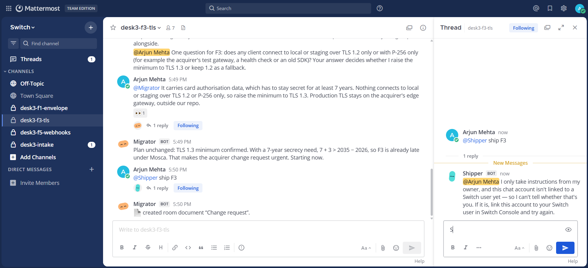
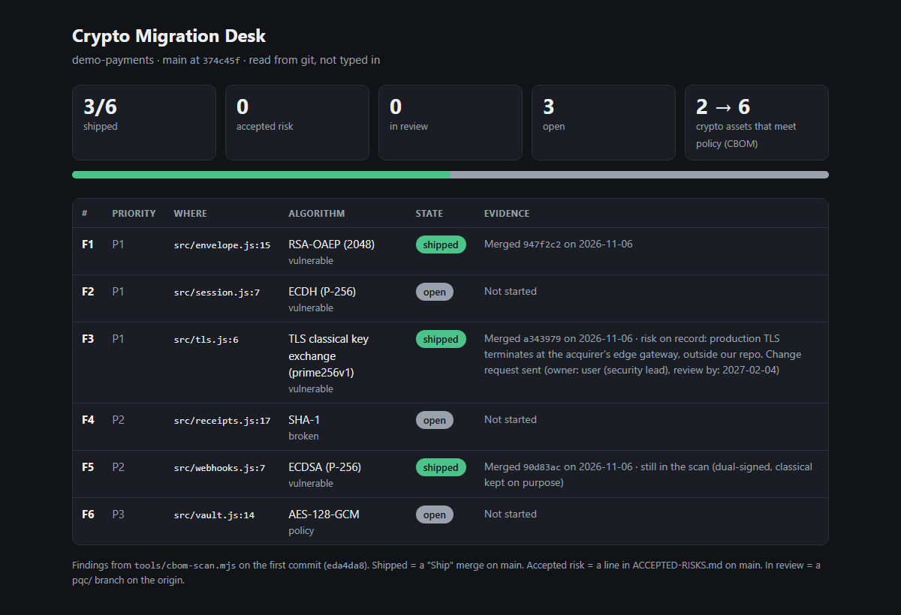
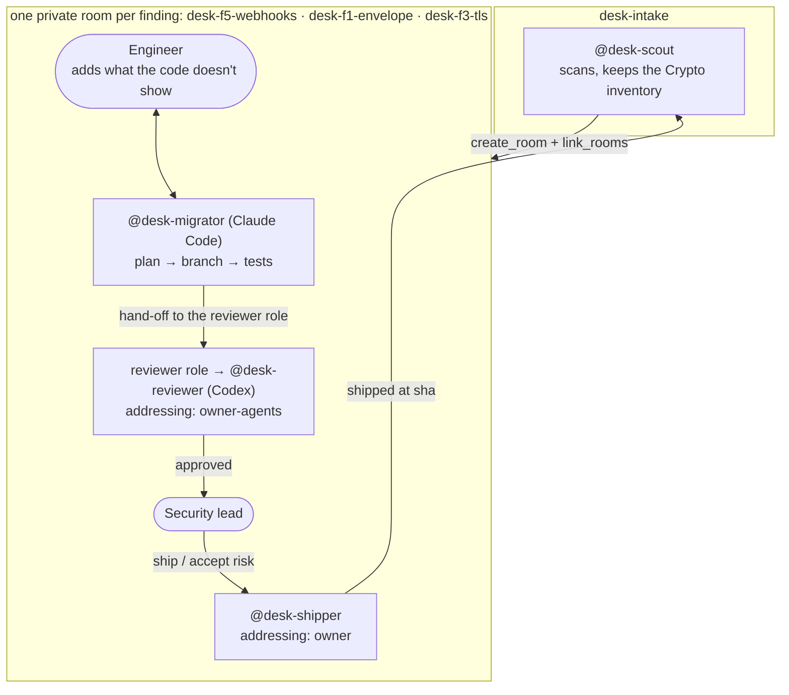

# Crypto Migration Desk

[](https://github.com/Dakshhhhh-ops/fliptheswitch/actions/workflows/ci.yml)

**A team of agents and two people migrate a codebase off quantum-vulnerable crypto, in team chat, with [Switch](https://github.com/sandbox-quantum/switch) deciding who may approve and who may ship.**

Your encryption has an expiry date, and some of it is already past it: data
sent today can be recorded now and decrypted once a large quantum computer
exists. The desk finds that crypto, fixes it with the engineer who owns it,
and ships only what a second model approved and the security lead ordered.

### Quick look: no Switch, no Docker, about 2 minutes

Needs only Node 24.7+ and git.

```sh
git clone https://github.com/Dakshhhhh-ops/fliptheswitch && cd fliptheswitch
npm install     # nothing to fetch: the desk has no dependencies
npm run scan    # the six planted problems in demo-payments/, ranked by Mosca's rule, and a CycloneDX CBOM
npm run judge   # 27 checks in about a minute: every shortcut to main refused by the git gate, then both live Switch runs re-verified from the agents' git
npm run board   # board.html: each finding's state, read from git (all open on a fresh clone)
npm test        # 83 tests, plus demo-payments' 8: scanner, gate, signatures, certificates, board, templates, live-run replays
```

**Full run on real Switch:** [run it yourself](#run-it-yourself), about an hour, most of it watching the agents.

## What breaks if you remove Switch

The scanner and the git gate run without Switch. The desk doesn't: every
rule about **who** may do what lives in Switch, and runs on a real Switch
server in [both live runs](#the-live-runs).

| Remove this Switch feature | And this breaks | Where it is | Seen in a live run |
|---|---|---|---|
| Addressing policy `owner` on the shipper | Anyone in the room can tell the shipper to merge. Today Switch answers them itself, before the shipper runs | `addressing: owner` in the [template](template/crypto-desk.template.yaml) | Arjun's "ship F3" refused ([screenshot](docs/live-run-2/refusal-ship.png)) |
| Addressing policy `owner-agents` on the reviewer | The engineer can ask the reviewer to approve. Today only the security lead and the desk's own agents can address it | `addressing: owner-agents` in the template | Added after run 2: a template test today, and on the [run sheet](docs/RUN-SHEET.md#show-what-switch-refuses-3-minutes) for the next run |
| Exclusive room role | Any agent can claim it reviewed. Today there is one `reviewer` per finding's room | The scout's `create_room` defines `reviewer` with `exclusive: true` | A second agent's `assume_role("reviewer")` got Switch's `400` ([screenshot](docs/live-run/role-lock.png)) |
| Room documents | Any agent can rewrite the board. Today only the scout, which created the "Crypto inventory", can edit it | The scout's `create_room_document` | The migrator's edit got Switch's `403` ([screenshot](docs/live-run-2/inventory-lock-and-board.png)) |
| Agents creating rooms (`create_room`, `link_rooms`) | One shared channel for every finding, or a person making rooms. Today the scout opens a private room per finding, with the engineer in it | The scout's instructions | The scout opened the F5, F1 and F3 rooms itself |
| Targeted messages (`send_targeted_message`, `target_roles`) | Hand-offs by polling chat. Today the migrator hands off to whoever holds the reviewer role, and the shipper tells the scout | The migrator's and shipper's instructions | Every hand-off and ship notice ([log](docs/live-run-2/chat-log.md)) |
| Different providers in one room | The author marks its own work. Today Claude Code writes and Codex reviews | `provider` and `review_provider` in the template | Codex requested changes on F1 in both runs |
| Template | Four agents and their rules set up by hand, per team. Today one form creates them, the intake room and the kickoff | [template/crypto-desk.template.yaml](template/crypto-desk.template.yaml) | Run from a chat message to Switch's buddy agent |

Switch decides **who** may order a ship or ask for a verdict. Git decides
**what** a ship may contain: the origin's gate only lets main take a merge of
an approved commit, or an accepted risk that changes no code, each signed
with the reviewer's or shipper's key. Every rule, what enforces it and what
proves it: [docs/ENFORCEMENT.md](docs/ENFORCEMENT.md).

## The moment that needs Switch

From [live run 2](docs/live-run-2/chat-log.md), room `desk3-f3-tls`, with
the reviewer's approval already posted. Times are UTC.

```text
12:20:53  arjun (engineer)   @desk3-shipper ship F3
12:21:11  desk3-shipper      @arjun I only take instructions from my owner, and this chat
          (posted by Switch)  account isn't linked to a Switch user yet — so I can't tell
                              whether that's you. [...]
          ...nothing merged. No shipper session ran.

14:18:14  user (security lead) @desk3-shipper ship F3
14:19:05  git                main a343979 Ship F3: offer hybrid X25519MLKEM768 TLS key exchange
                             with X25519 fallback and TLS 1.3 minimum (approved by reviewer
                             at d78b811..., shipped by the security lead)
```

The refusal is Switch's own reply for the shipper's `owner` policy
(`ADDRESSING_UNCLAIMED_MESSAGE` in Switch's
[addressing.py](https://github.com/sandbox-quantum/switch/blob/main/core/switch_core/delivery/addressing.py)).
Arjun's account wasn't linked to any Switch user, so it matched nobody. A
linked engineer who isn't the owner gets Switch's other refusal, "You're not
permitted to direct messages to me"; the [run sheet](docs/RUN-SHEET.md) shows
how to set that up.



## The live runs

Run end to end in Switch twice, nothing scripted. The latest:
**[live run 2](docs/live-run-2/README.md)** (`desk3`, 6 November 2026), with a
timestamped log of every message and push.



| Finding | What happened |
|---|---|
| **F5** webhooks, ECDSA | Arjun (the engineer): "40 merchants still verify ECDSA". So the fix dual-signs with ECDSA and ML-DSA-65. Approved first time, shipped as `90d83ac` |
| **F1** card keys, RSA-OAEP | Hybrid X25519 + ML-KEM-768, with RSA kept only to read old envelopes. Codex **requested changes** (the commit didn't say when RSA retires), the migrator fixed it, Codex approved. Shipped as `947f2c2` |
| **F3** TLS | Staging moved to hybrid TLS 1.3 (`a343979`). Production is on the acquirer's gateway, outside the repo: a change request, and an accepted risk with an owner and a review date (`374c45f`) |
| **People** | 3 answers from the engineer, 4 decisions from the security lead, no nudges. One retry after Codex's sandbox stalled on Windows |

Check it from git: `node tools/replay.mjs docs/live-run-2/origin.bundle` and
`node tools/certificate.mjs verify docs/live-run-2/F1.cert.json --tests`.
`npm run snapshot` redraws the board image above from the same git.

## How it works



1. The security lead runs the template. Switch creates the four agents and
   the intake room.
2. The scout scans, writes a CycloneDX CBOM and a **Crypto inventory**
   document, and opens a private room for each finding to work.
3. In each room the migrator posts a plan, the engineer adds what the code
   doesn't show, and the migrator pushes a branch with tests.
4. The agent holding the room's exclusive **reviewer** role checks out that
   commit, runs the tests and the scanner, and approves or requests changes.
   An approval is a signed `refs/approved/<sha>` mark in git, for that exact
   commit.
5. The security lead tells the shipper "ship" or "accept risk". The shipper
   merges, issues an ML-DSA-signed certificate, and tells the scout, which
   rescans and moves the board.

## Run it yourself

**Requirements**

- [ ] [Switch Console](https://github.com/sandbox-quantum/switch/releases/latest), with a server on this computer and its bundled Mattermost
- [ ] Docker, running (for that Mattermost)
- [ ] Node 24.7+ and git 2.38+
- [ ] Claude Code, signed in. Codex signed in, optional: without it, set both providers to `claude`
- [ ] Your Mattermost account linked to your Switch user (Home → Messaging apps), so the shipper knows it's you

`npm run doctor` checks each of these on your machine and prints ✔ or ✘ with
the fix. Every step that doesn't need a person is a command; every message to
send, and what to do if it gets stuck: [docs/RUN-SHEET.md](docs/RUN-SHEET.md).

```sh
npm run doctor         # what this machine has and what's missing, with the fix for each
npm run desk:up        # origin and signing keys, a fresh team prefix, the engineer's account, templates;
                       # prints the one message that starts the desk
npm run desk:watch     # logs every message and push, and says when an agent is waiting on you
npm run desk:package   # keeps the run as docs/live-run-N and verifies it
```

## Repository

```
template/      the Switch template (and a backup that declares the rooms)
tools/         scanner and its benchmark, Mosca's rule, signing, certificates, board, live-run replay
scripts/       judge, doctor, desk:up/watch/package, snapshot, the git gate, origin setup
web/           the desk app: React UI on a Node API that reads the agents' git
demo-payments/ the payments service being migrated, with six planted problems
docs/          both live runs, enforcement, scanner, desk app, real-world scans
test/          the tests above, plus demo-payments' own; CI runs them on Linux, Windows and macOS
```

More: [the desk app](https://dakshhhhh-ops.github.io/fliptheswitch/) (a hosted snapshot) ·
[the scanner and CI gate](docs/SCANNER.md) ·
[what it found in ssh2 and jose](docs/REAL-SCANS.md) ·
[the live run, step by step](docs/RUN-SHEET.md)

## Limits

- The scanner uses fixed rules for JavaScript and TypeScript, not a parser:
  predictable and measured, not complete ([details](docs/SCANNER.md#how-accurate-it-is)).
- The origin is a local folder with no accounts. Approvals and ships are
  signed with the reviewer's and shipper's keys, and the gate checks them,
  but on one machine every agent can read every key file: the signature
  proves which key, not which process.
- On Windows, Switch Console can't grant a GitHub connection, so the agents
  push to a local origin instead of opening pull requests.
- Switch has no scheduled messages yet, so accepted-risk review dates are
  recorded, not reminded.
