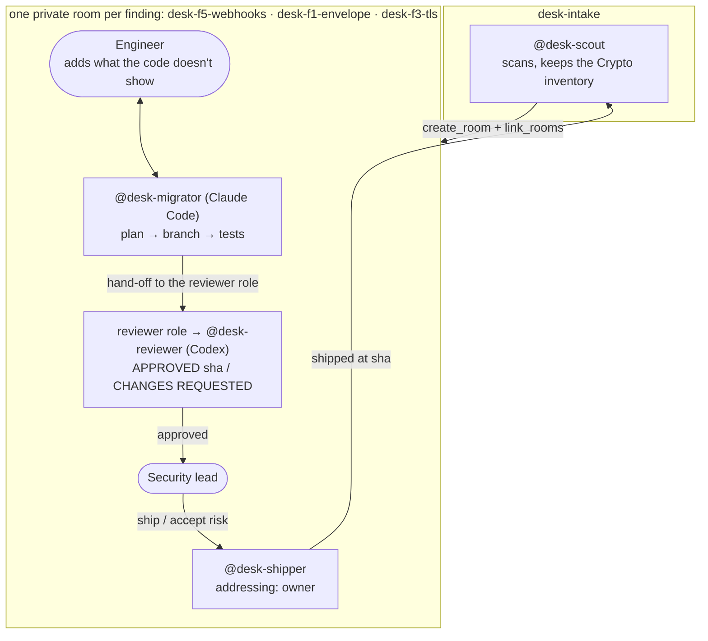

# Crypto Migration Desk

[](https://github.com/Dakshhhhh-ops/fliptheswitch/actions/workflows/ci.yml)

**Your encryption has an expiry date. Some of it is already past it.**

**[Open the desk app](https://dakshhhhh-ops.github.io/fliptheswitch/)** · [Judge it in 90 seconds](#judge-it-in-90-seconds) · [The live run](docs/live-run/README.md) · [Why it needs Switch](#why-it-needs-switch) · [Run it yourself](#run-it-yourself)

Data sent today with classical crypto can be recorded now and decrypted once
a large quantum computer exists. [ssh2](https://github.com/mscdex/ssh2), one
of npm's most used SSH libraries, offers only classical key exchange. For
data that must stay secret for years, that's a problem now, not in 2035
([Mosca's rule](docs/SCANNER.md#moscas-rule)).

Crypto Migration Desk runs the migration in team chat with
[Switch](https://github.com/sandbox-quantum/switch). Four agents and two
people:

- a **scout** finds every quantum-vulnerable use of crypto and opens a
  private room per finding, with the engineer who owns the code
- a **migrator** (Claude Code) writes the fix with the engineer
- a **reviewer** on a different model (Codex) approves the exact commit
- a **shipper** merges it, and only on the **security lead's** word: Switch
  refuses anyone else, and git refuses anything unreviewed

## Judge it in 90 seconds

1. **Watch the agents in Switch:** [the live run](docs/live-run/README.md),
   with screenshots of every refusal.
2. **Check it yourself, nothing to install** (Node 24.7+):
   ```sh
   git clone https://github.com/Dakshhhhh-ops/fliptheswitch && cd fliptheswitch
   npm run judge
   ```
   19 checks in about 25 seconds. It plays the desk's git moves against the
   real gate (every shortcut refused, the approved ship accepted), then checks
   the **live Switch run** from the git history the agents left: their
   signed certificates, every push replayed through the gate, and the board.
3. **Scan your own code:** `node tools/cbom-scan.mjs ../your-repo`
   ([more](docs/SCANNER.md)).

## The live run

Run end to end in Switch on 5–6 November 2026. Write-up, screenshots,
certificates and the agents' git history: [docs/live-run/](docs/live-run/README.md).

**Shipped 2/6 · Accepted risk 1 · Open 3**

| Finding | What happened |
|---|---|
| **F5** webhooks, ECDSA | Arjun (the engineer): "40 merchants still verify ECDSA". So the fix dual-signs with ECDSA and ML-DSA-65. Approved first time, shipped as `7761387` |
| **F1** card keys, RSA-OAEP | Wrapped with hybrid X25519 + ML-KEM-768. Codex **requested changes**, the migrator added a test, then it was approved and shipped as `33c152b` |
| **F3** TLS | Production TLS is on the acquirer's gateway, outside the repo: an accepted risk with an owner and a review date (`d248e99`) |
| **Refusals** | Switch refused Arjun's "ship F1" [before any agent ran](docs/live-run/refusal-ship.png), refused a second agent the [reviewer role](docs/live-run/role-lock.png), and refused an edit to the [scout's inventory](docs/live-run/inventory-lock.png) |

Check it from git: `node tools/replay.mjs docs/live-run/origin.bundle` and
`node tools/certificate.mjs verify docs/live-run/F1.cert.json --tests`.

## How it works



1. The security lead runs the template. Switch creates the four agents and
   the intake room.
2. The scout scans, writes a CycloneDX CBOM and a **Crypto inventory**
   document, and opens a private room for each finding to work.
3. In each room the migrator posts a plan, the engineer adds what the code
   doesn't show, and the migrator pushes a branch with tests.
4. The agent holding the room's exclusive **reviewer** role checks out that
   commit, runs the tests and the scanner, and approves or requests changes.
   An approval is a `refs/approved/<sha>` mark in git, for that exact commit.
5. The security lead tells the shipper "ship" or "accept risk". The shipper
   merges, issues an ML-DSA-signed certificate, and tells the scout, which
   rescans and moves the board.

## Why it needs Switch

Take Switch away and the desk stops working. These parts are Switch's:

| Switch feature | What it does here | Without it | In the live run |
|---|---|---|---|
| Template | One form creates the four agents, the intake room, its guide document and the kickoff | Four agents and their rules set up by hand, per team | Run from a chat message to Switch's buddy agent |
| Agents creating rooms (`create_room`, `link_rooms`) | The scout opens a private room per finding with the right people | One shared channel for every finding | The scout opened the F5, F1 and F3 rooms itself |
| Addressing policies | `owner` on the shipper is the ship gate | Any agent obeys anyone who can type in the room | Arjun's "ship F1" refused before an agent ran ([screenshot](docs/live-run/refusal-ship.png)) |
| Exclusive room role | One reviewer of record per finding | Any agent can claim it reviewed | A second agent's `assume_role("reviewer")` got Switch's `400` ([screenshot](docs/live-run/role-lock.png)) |
| Room documents | Only the scout can edit the inventory, so the board can't be quietly changed | Any agent can rewrite it | The migrator's edit got Switch's `403` ([screenshot](docs/live-run/inventory-lock.png)) |
| Targeted messages | Hand-offs go to whoever holds the reviewer role; the shipper tells the scout what shipped | Agents polling chat for their name | Every hand-off and ship notice |
| Rooms shared by people and agents | Engineer, security lead and agents negotiate in one thread | Constraints relayed by hand between tools | Arjun's constraints changed both fixes |
| Different providers in one room | Claude Code writes, Codex reviews | The author marks its own work | Codex requested changes on F1 ([screenshot](docs/live-run/review-changes-requested.png)) |

Switch decides **who** may order a ship. Git decides **what** a ship may
contain: the origin's gate only lets main take a merge of an approved commit,
or an accepted risk that changes no code. Every rule, what enforces it and
what proves it: [docs/ENFORCEMENT.md](docs/ENFORCEMENT.md).

## Run it yourself

You need [Switch Console](https://github.com/sandbox-quantum/switch/releases/latest)
with its Mattermost (which needs Docker), Node 24.7+, git 2.38+ and Claude
Code. Codex is optional: without it, set both providers in the form to
`claude`.

```sh
npm run doctor   # what this machine has and what's missing, with the fix for each
npm run setup    # the local git origin with its gate; prints the folder for the form
```

1. In Switch Console, add a server on this computer with Mattermost.
2. **Link your Mattermost account to your Switch user** (Home → Messaging
   apps). The shipper only obeys its owner, and can't tell it's you until
   then.
3. Create a second Mattermost account for the engineer, and don't link it.
4. Templates → Import [`template/crypto-desk.template.yaml`](template/crypto-desk.template.yaml),
   fill in the folder and the engineer's username, and create it.
5. Watch `desk-intake`. Answer the agents from the engineer's account, and
   approve from yours.

`npm run reset` puts the planted code back. Everything stays on your machine.
If the scout keeps failing to open rooms, import
`template/crypto-desk-fixed-rooms.template.yaml` instead.

## Repository

```
template/      the Switch template (and a backup that declares the rooms)
tools/         scanner, Mosca's rule, certificates, board, live-run replay
scripts/       judge, doctor, the git gate, origin setup
web/           the desk app: React UI on a Node API that reads the agents' git
demo-payments/ the payments service being migrated, with six planted problems
docs/          the live run, enforcement, scanner, desk app, real-world scans
test/          60 tests, plus demo-payments' own; CI runs them on Linux, Windows and macOS
```

More: [the scanner and CI gate](docs/SCANNER.md) ·
[the desk app](docs/DESK-APP.md) ·
[what it found in ssh2 and jose](docs/REAL-SCANS.md) ·
[the demo video run-sheet](docs/DEMO.md)

## Limits

- The scanner uses fixed rules for JavaScript and TypeScript, not a parser:
  predictable, not complete ([details](docs/SCANNER.md#limits)).
- The origin is a local folder with no accounts, so git can't tell which
  agent pushed. Switch's addressing decides who may order a ship; the gate
  decides what it may contain.
- On Windows, Switch Console can't grant a GitHub connection, so the agents
  push to a local origin instead of opening pull requests.
- Switch has no scheduled messages yet, so accepted-risk review dates are
  recorded, not reminded.
